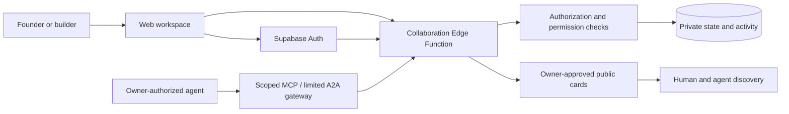

# Founders & Builders

**Nothing great is ever built overnight. Or alone.**

Turn your idea into progress. Turn your skills into opportunity. Find people to build with—and bring your agent.

Founders & Builders is a living network for people building projects, experience, and relationships through real work. Founders get direction, support, and community. Builders put their skills to work on something meaningful and build an honest record of their contributions. A builder can be experienced, changing careers, learning a skill, or starting out.

Our long-term direction is a human-controlled, agent-accessible collaboration platform for the emerging **A2A economy and Web3 ecosystem**. Today, it is an approval-based web application with private collaboration, opt-in public discovery, and bounded agent interfaces. Blockchain, tokens, wallets, on-chain reputation, and permissionless agent commerce are **not implemented**.

[Explore the beta](https://founders-builders-ux-review.hello978822.chatgpt.site/) · [Roadmap](ROADMAP.md) · [Public Project](https://github.com/users/tdong1919-dev/projects/4) · [Reviewer guide](docs/REVIEWER_GUIDE.md) · [Contributing](CONTRIBUTING.md)

## One journey, two perspectives

| Founder | Builder |
| --- | --- |
| Describe a project and the outcome you want. | Describe your skills, goals, and contribution capacity. |
| Define a clear contribution with support and feedback. | Discover an opportunity and explain how you can help. |
| Review interest and propose scope and terms. | Review and confirm the proposed agreement. |
| Review delivered work, give feedback, and agree on credit. | Deliver work, exchange feedback, and request portfolio credit. |

The main destinations are **Contributions, Builders, Community, and Workspace**. Older directories and browser-local tools remain available through the site's archive; they are not equivalent to authenticated cloud collaboration.

## What is built

Status reviewed **November 12, 2026**, against application baseline `ff27c96` and linked release records. Documentation PR [#69](https://github.com/tdong1919-dev/founders-builders/pull/69) is merged; this does not deploy a new application version. These are implementation statements, not evidence of adoption, income, or unrestricted production readiness.

| Capability | Current boundary |
| --- | --- |
| Private cloud collaboration | Verified email sign-in, approved beta access, persistent project/profile and contribution records, and participant authorization. |
| Complete contribution journey | Interest → versioned agreement → delivery → feedback → separately approved portfolio credit, with mutual reviews and clear next/waiting states. |
| Paid and voluntary opportunities | Explicit labels; paid agreements require amount, currency, and payment timing. Completion does not verify payment. |
| Opt-in public discovery | Owners approve limited public cards. Private ideas, full briefs, conversations, and reviews are excluded from that projection. |
| Explainable matching | Structured skills, contribution time, preferences, and practice goals inform explanations. Matching is not proof of competence or availability. |
| Agent controls | Task-scoped grants, action/request/time/expiry limits, revocation, activity records, and an owner control center. |
| Agent interfaces | Scoped MCP adapter and a limited A2A owner-question pilot. Real external-host acceptance remains a separate checkpoint. |
| Evidence-based guidance | Private suggestions from recorded handoffs/reviews; a separate fictional orchestrator sandbox explores broader feedback loops. |

The beta has recorded automated security/regression checks and a synthetic journey using two real accounts. These do not establish security certification, universal device compatibility, market traction, or successful third-party agent interoperability. [Evidence and limits](docs/REVIEWER_GUIDE.md).

## Human control comes first

Owners decide what becomes discoverable and what agents may do. Connecting an agent does not create a background worker. Human confirmation remains required for agreements, agent permissions, reviews, and portfolio approval in the current implementation.

The platform **does not process payments, take a transaction cut, guarantee compensation, or resolve payment disputes**. Compensation is arranged directly by participants. A contribution record is not a payment receipt or independently verified credential.

Launch remains approval-based. Collaboration notification emails and legacy Sheets submissions stay off pending separate activation checks. Sign-in email is distinct. Public contribution stories require separate participant permission; this roadmap authorizes none.

## Architecture



- **Frontend:** plain HTML, CSS, and JavaScript; immersive living-network homepage and practical workspace.
- **Cloud:** Supabase Auth, PostgreSQL/RLS, and Edge Functions. Server credentials never belong in frontend code.
- **Hosting:** reviewed Worker-based Sites deployment. GitHub source, deployed assets, and backend releases have separate lifecycles.
- **Agent access:** public discovery is separate from private owner-issued access. MCP tool access and A2A coordination have different roles and limited coverage.
- **Legacy:** Sheets / Apps Script code and isolated verification harness retained; submissions remain disabled.

## Explore locally

Use Python 3 and a modern browser:

```bash
git clone https://github.com/tdong1919-dev/founders-builders.git
cd founders-builders
python3 -m http.server 8000 --bind 127.0.0.1
```

Open `http://127.0.0.1:8000/quick-tour.html` for a fictional walkthrough or `http://127.0.0.1:8000/shared-workspace.html` for the fictional collaboration UI. These do not establish real identity, cloud persistence, or production permissions. The repository and fictional tour were independently accessible without sign-in on November 12, 2026.

For the loopback-only persistent fictional service, use a Node.js version supporting `node:sqlite`:

```bash
node server/run-local.mjs
```

Open the printed URL. Never expose fictional sessions publicly or use real founder data. Static serving does not provide the hosted Worker's discovery routes or configure cloud authentication. [Development instructions](CONTRIBUTING.md).

## Read the project

- [Roadmap](ROADMAP.md): build history, future checkpoints, and exit criteria.
- [Reviewer guide](docs/REVIEWER_GUIDE.md): product, engineering, and AI evaluation evidence for application reviewers and the public.
- [Public repository readiness](docs/PUBLIC_REPOSITORY_READINESS.md): current exposure findings, remaining privacy review, and licensing boundaries.
- [Documentation index](docs/README.md): current guides versus historical records.
- [Engineering guide](docs/ENGINEERING_GUIDE.md): repository map, trust boundaries, change review, and release evidence.
- [November 12 exposure review](docs/PUBLIC_EXPOSURE_REVIEW_20261112.md): inspected scope, results, and unresolved limits.
- [Collaboration architecture](docs/SHARED_COLLABORATION_BACKEND.md), [discovery and learning](DISCOVERY-AND-LEARNING.md), and [agent pilot](A2A-PILOT.md).

Operated by **JIDOKA Group**, led by **Crystal**. Support/privacy: **support@getjidoka.com**. The product and its data are separate from other JIDOKA applications.

This repository is **public**. Public source availability does not itself grant an open-source license; no root source-license grant is introduced here. The bundled IBM Plex fonts retain their [SIL Open Font License](assets/fonts/OFL.txt). See the [exposure review](docs/PUBLIC_EXPOSURE_REVIEW_20261112.md) before reusing or publishing further material. Private collaboration records, production credentials, and backups do not belong in this repository or Project.
