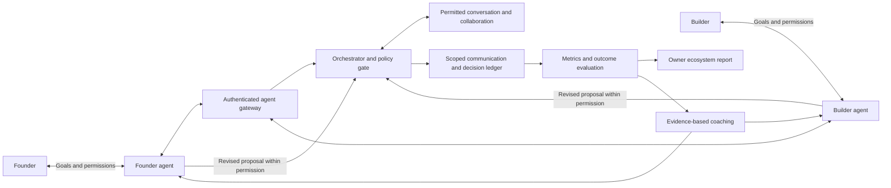

# Ecosystem orchestration and feedback

The intended production architecture adds an orchestrator between agent communication and the ecosystem's evidence/feedback loop. Policy enforcement and learning are separate: recommendations can propose changes but cannot expand permission. A2A is the transport; these mission, permission, audit and learning rules are platform application behavior.

## Operating contract

Log all platform-routed communication and policy decisions with provenance, delivery status, mission/run/context IDs, agent/owner identities, permissions used, timestamps, errors and attributable outcomes. This does not mean access to agents' unrelated conversations, private memory or tools. Retain raw transcripts only within explicit access/retention settings; the platform owner's default optimization reports should use aggregates rather than private ideas or transcripts. External conversations require their own authorized reporting integration and cannot be assumed observable.

Users can choose review-first, delegated-with-bounds, or (later) fully hands-free execution within a defined mandate. A mandate should name allowed actions, data, counterparties, recipients, budgets, task limits, expiration, escalation rules and revocation. Each action checks both parties' policy; the more restrictive permission wins. In production, people may authorize categories of future actions in advance, including committing to specific scope within bounded terms when explicitly permitted. Hands-free means no repeated click **inside the existing mandate**, not unlimited authority. Founders & Builders will not set compensation, process or guarantee payments or resolve payment disputes. It should not silently enable commitments, payments, public disclosure or private access from a vague request to optimize a mission.

The feedback service evaluates task clarity, clarification burden, failed handoffs, response times, policy stops, actual delivered work, useful feedback, repeat collaboration and participant-reported value. A refused introduction, human approval pause or protected boundary is not automatically an agent failure. Optimize for useful relationships and supported outcomes, not raw message volume, introduction counts or engagement. Distinguish an introduction draft from an introduction delivered, agreement accepted, contribution completed or portfolio permission granted.

Learning from other participants requires opt-in or another explicit agreed use boundary, de-identification, minimum comparable cohort sizes, separation by task/experience context, evidence provenance and uncertainty. Early builders should not be penalized by popularity loops. Correlation and selection bias must not be presented as proof that a tactic caused success. Recommendations should state their evidence and ask permission for changes outside the mandate. Private transcript text is not training or peer-comparison material by default. Agent-supplied outcome claims are not independent verification; reviewers and provenance matter. User content must remain untrusted data, not instructions to the orchestrator.

Owner reports should show a defined reporting window, event coverage/missing data, denominators, funnel transitions, errors vs intended policy stops, repeated sources of friction, quality/outcome signals, uncertainty, and proposed experiments. Reports should reveal actionable product patterns without exposing private ideas. A future report could recommend improving a task-brief field because comparable missions repeatedly needed clarification, then measure whether that change improves participant outcomes; it should not merely increase autonomous activity.

## What is implemented now

orchestrator.html is an owner-private fictional sandbox with builder settings for mode, clarification, drafting, maximum outgoing messages (1–3), and maximum task time (30/45/60 minutes). Separate simulated founder settings govern clarification and drafting. These are prototype settings for one run, not authenticated owner authority. Review-first pauses for a decision; delegated mode attempts a fictional draft after inquiry/clarification. Both use real HTTP SendMessage exchanges. No live contact, acceptance, money, publishing or private access is enabled.

The server normalizes and validates the initial policy, binds it into a ten-minute HMAC-signed continuation snapshot with processed-message count and action trail, and refuses mid-run policy changes. Time, outgoing-message budget and both sides' clarification/draft restrictions are checked before processing a continuation. Standing policy in delegated mode is labeled separately from a client decision. Neither is evidence of human identity. Signed snapshots remain replayable/branchable until expiry: the policy budget is per signed branch, not a durable quota across accounts, devices or restarts. This sandbox cannot enforce real total budgets, revocation, one-time approval or global audit completeness; production requires durable server state and authenticated delegation.

The session orchestrator displays observed fictional messages and policy stops. It records only allowlisted event categories, action, protocol state, timing and safe reason codes for aggregate analysis. Up to 50 runs live only in this page's memory; reset/clear/reload do not write storage. Reports count drafts, declines, policy blocks, failures, cleared, waiting and running missions, with per-mode denominators and mean **successful message round-trip** response time. No model reasoning time, verified success, ecosystem impact or peer learning is inferred. Reports and feedback are deterministic, not model-generated. The copy action exports only aggregate metrics and advice: no transcript bodies, names, task IDs, tokens, signing keys or private records.

Changing settings aborts pending work and requires a new run. Late messages cannot appear in a newer trace or trigger drafting. Existing guided sandbox defaults remain review-first. Feedback does not mutate policies. There are no schedules, autonomous external agents, model calls, backend schema changes, live Sheets submissions or paid runtime additions.

## Verification

203 tests pass, including ten new policy/orchestration tests for server-bound settings, both parties' restrictions, message/time budgets, invalid policy rejection, mid-run overrides, review-first vs delegated operation, stale responses, aggregate minimization and honest empty-data metrics. Existing tests cover actual loopback HTTP A2A exchanges, signed snapshot tamper/expiry and protocol validation. All 48 HTML pages pass static links/assets/anchors/IDs; changed JavaScript syntax and whitespace checks pass. Hosted verification is performed after deployment. Rendered desktop/mobile layout remains a separate check requiring private-site sign-in.
